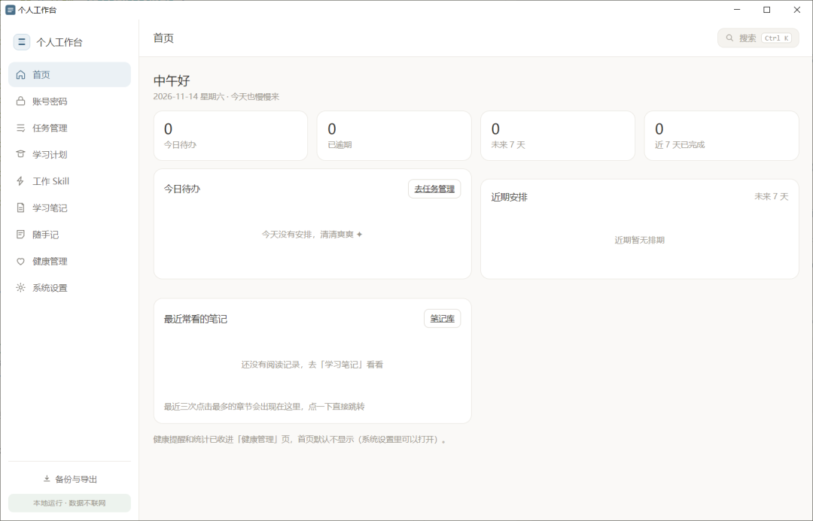
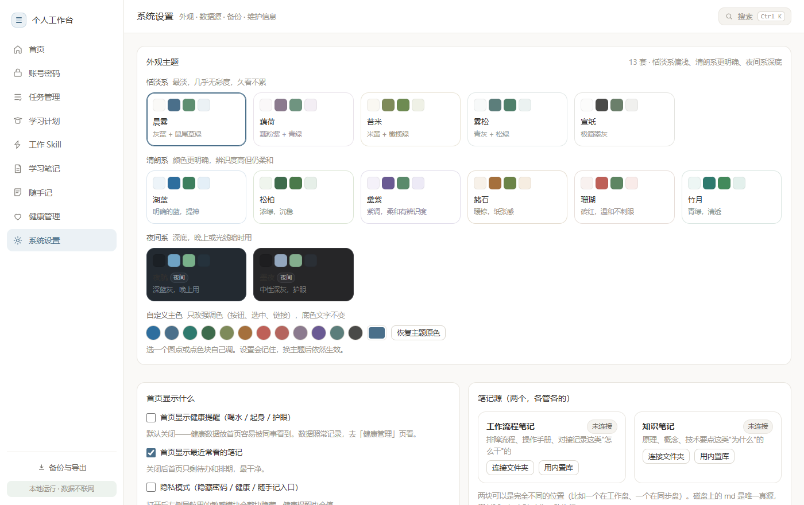
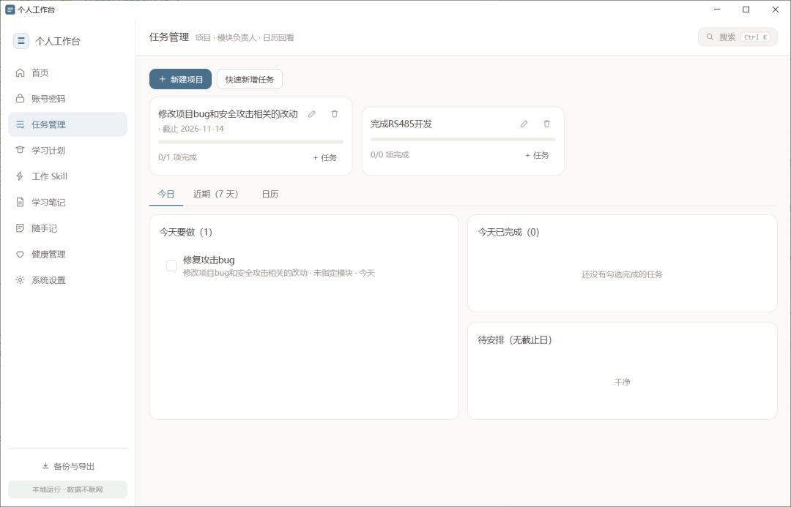
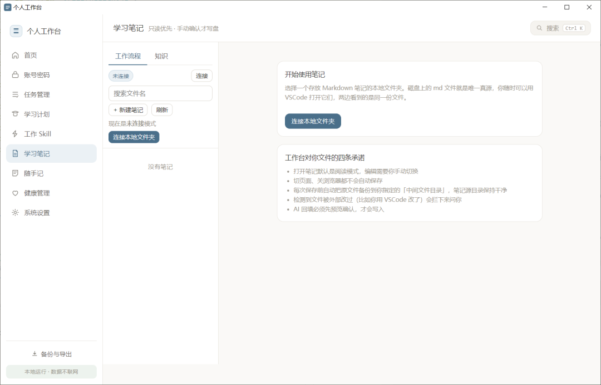

# Personal Workbench · 个人工作台

**任务、密码、笔记、学习、健康提醒，全在一个界面里。数据只在你自己的电脑上——不联网、不注册、不订阅、不上传。**


[](../../releases/latest)

> 待办在 Todoist，笔记在 Notion，密码在浏览器，学习进度在 Excel，随手记在手机备忘录。
> 这个工作台把它们收进一个本地页面：打开就能用，关掉不留痕。



## 为什么值得试

- **打开就是你的数据**：没有注册、没有引导、没有付费墙。双击 exe，界面就在那儿。
- **笔记就是普通 `.md` 文件**：躺在你自己的文件夹里，随时用任何编辑器打开，不怕哪天服务关停。
- **手滑不心疼**：写之前自动备份，文件被别的程序改过会拦下来问你，删除只进回收站。
- **不用装环境**：安装包自带运行时，电脑上没有 Node.js 也能跑。
- **AI 不用配 Key**：一键生成「工作台现状快照」丢给 Cursor / VSCode，它就知道你手上有什么活。
- **想改就能改**：原生 JS，无框架、无构建步骤，改完刷新就生效。

## 和常见方案比

|  | 个人工作台 | Notion | Obsidian | 云端待办 App |
|---|---|---|---|---|
| 数据存在哪 | 你的硬盘 | 厂商的云 | 你的硬盘 | 厂商的云 |
| 要注册登录 | 不用 | 要 | 不用 | 要 |
| 断网能用 | 能 | 基本不能 | 能 | 不能 |
| 笔记格式 | 普通 `.md` | 私有格式 | 普通 `.md` | 私有格式 |
| 任务 / 密码 / 学习 / 健康 | 一个界面全有 | 要自己搭 | 要装一堆插件 | 分散在几个 App |
| 订阅费 | 0 | 有免费额度限制 | 0（同步要付费） | 有 |

不是要替代谁。它解决的是：**不想把私人数据交给别人托管的场景**，而且只放在自己电脑上。

## 特性

**数据自主**
- 所有数据在本机，程序不联网、不调任何第三方 API。
- 笔记直连你选择的文件夹，取消授权就断开，文件永远是你的。
- 备份 / 回收站 / 导出都是普通文件，用系统资源管理器就能看。

**用起来省心**
- 一屏看清今天：今日待办、逾期、项目进度、学习打卡。
- 「项目 → 模块 → 任务」三层拆任务，带负责人和截止日，可切日历视图。
- 一个搜索框（`Ctrl K`）搜笔记、任务、密码、Skill。
- 密码分组存放，界面遮挡显示，复制后自动清空剪贴板。
- 喝水 / 起身 / 护眼的弱提醒，不弹窗打断你。

**好看**
- 13 套主题（恬淡 / 清朗 / 夜间）+ 12 种主色，全部走 CSS 变量，白天晚上都舒服。

**和 Cursor 打通**
- 一键在 Cursor / VSCode 里打开当前笔记的对应行。
- Skill 能装进 Cursor 用户目录，装一次所有项目都认；也能导成 `.cursor` 文件夹拷到项目里。



## 功能一览

| 模块 | 说明 |
|---|---|
| 首页 | 今日待办、逾期、项目进度、学习打卡汇总 |
| 账号密码 | 分组管理，界面遮挡显示，复制后自动清空剪贴板 |
| 任务管理 | 项目 / 模块 / 负责人 / 截止日，支持日历视图 |
| 学习计划 | 阶段打卡、连续天数 |
| 工作 Skill | 可复用提示词模板，可导出 `.cursor` 包或一键装到本机 Cursor |
| 学习笔记 | Markdown 编辑 + 大纲，直连磁盘或存内置库 |
| 随手记 | 标签、置顶、全文搜索 |
| 健康管理 | 喝水 / 起身 / 护眼的弱提醒 |
| 系统设置 | 主题、数据源、备份、迁移文档、AI 联动 |





## 下载安装

到 [Releases](../../releases) 下载：

- `PersonalWorkbench-Setup-x.y.z.exe` — 安装版（推荐）
- `PersonalWorkbench-x.y.z-portable.exe` — 免安装版

双击即可，支持 Windows 10 / 11（x64），**不需要单独装 Node.js**。首次打开会自动拉起本地服务，界面在应用窗口里，关掉窗口退到托盘不退出。

## 从源码运行

需要 Node.js 18 以上：

```bash
git clone https://github.com/HiwwHi/personal-workbench.git
cd personal-workbench
npm install
npm start        # 桌面版（Electron，带托盘）
```

只想用浏览器：

```bash
npm run server     # 等价于 node server.js，然后打开 http://127.0.0.1:8733
npm run selfcheck  # 自检：起临时服务跑一遍关键检查（不写文件、不联网）
```

Windows 也可以直接双击 `start-workbench.vbs`：无黑框启动 + 托盘图标（这条路径需要本机有 node，`tray.ps1` 会依次找项目 `runtime\node.exe`、系统安装的 node 和 PATH）。

> 8733 被别的程序占用时，服务会自动顺延到 8734 起，实际端口看启动日志第一行。

## 目录结构

```
personal-workbench/
├─ index.html              单页外壳
├─ server.js               本地服务（静态文件 + 受限接口）
├─ electron/main.js        主进程：起服务 / 开窗口 / 托盘
├─ electron/preload.js     桌面版专属能力（原生选目录）
├─ assets/
│  ├─ css/main.css         全部样式，配色走 CSS 变量
│  └─ js/
│     ├─ app.js            路由 / 搜索面板 / 备份
│     ├─ lib/              store / fsa / md / ui / health / model / aibridge
│     └─ views/            9 个页面模块
├─ scripts/selfcheck.js    自检脚本（npm run selfcheck）
├─ start-workbench.vbs     无黑框启动（源码方式）
├─ start-workbench.bat     兼容入口
├─ tray.ps1                托盘常驻 + 开机自启（源码方式）
└─ shots/                  界面截图（含示例数据，不随仓库分发）
```

## 数据存在哪

| 数据 | 位置 |
|---|---|
| 任务 / 账号密码 / 学习 / Skill / 随手记 / 健康 | 浏览器本地存储（按 origin 隔离） |
| 笔记正文 | 你授权过的文件夹里的 `.md` 文件 |
| 备份 / 回收站 / 导出 / Cursor Skill 包 | 你选择的「中间文件目录」 |
| 桌面版的信任目录白名单 | 用户数据目录 `%APPDATA%/Personal Workbench/` |

> 只复制程序文件夹**不会**带走数据。换电脑或重装系统前，先在「备份与导出」里导出一份 JSON。

## 常见问题

**换了端口，数据怎么不见了？**
数据按「地址」区分。8733 被占用、服务顺延到 8734 时，界面会看起来像空库——关掉占用 8733 的程序重新打开即恢复，数据一直都在。

**换电脑怎么搬？**
先在「备份与导出」导出 JSON，新电脑导入后再重新连接一次笔记文件夹。

**笔记会被改坏吗？**
每次写前备份到「中间文件目录/备份/」，文件被外部改过会先拦下来问你，删除只进回收站。

**一定要装 Cursor 吗？**
不用。编辑器联动是可选功能，VSCode 也行，都不用就纯浏览器用。

**「用 Cursor 打开」说找不到目录路径？**
浏览器只肯给文件夹的名字、不给真实路径，所以第一次连接文件夹后，桌面版会再弹一次窗口让你确认位置（也可以到「系统设置 → AI 联动」点「选择」补）。用托盘/浏览器方式打开时没有这个弹窗，需要把路径手动粘一次。

**手机能用吗？**
目前只支持 Windows 电脑本地运行。

## 隐私说明

- 不联网、没有账号系统、不上传任何东西。
- 本地服务每次启动都会生成一次性令牌，只有工作台页面能调它的接口；别的程序/网页即使猜到端口也调不动。
- **账号密码是明文保存的**，界面上只做了遮挡。这是刻意的取舍（简单、可导出、可搜索），但**请不要用它存高价值密码**（网银、主邮箱、云服务主账号）。
- 导出的备份 JSON 里密码同样是明文，别放网盘或发到聊天软件里。

## 适合拿来改

没有构建步骤，也没有框架要学：

- **换配色 / 加主题**：`assets/css/main.css` 里加一段 `[data-theme="id"]` 变量块，再到 `assets/js/views/system.js` 的 `THEMES` 数组加一条，刷新就看见。
- **加一个页面**：在 `assets/js/views/` 建一个模块，`app.js` 的 `views` 里注册，导航加一行。
- **加一个本地能力**：`server.js` 零依赖，加接口时记得过 `inRoots()` 校验，别给外部网页开口子；页面侧统一走 `assets/js/lib/aibridge.js` 的 `post()`，令牌校验会自动带上。
- **桌面版专属能力**（比如选目录拿真实路径）走 `electron/preload.js`：`contextBridge` 只放出需要的那一个函数，别把 Node 塞进页面——`contextIsolation` 和 `nodeIntegration: false` 要一直保持。
- `tray.ps1` 必须保持 UTF-8 带 BOM，否则 PowerShell 5.1 会把中文读成乱码。

## 打包

```bash
npm run dist     # 生成安装版与免安装版，输出到 release/
```

> 推 `v*` 标签会由 GitHub Actions 自动打包并挂到 Release（见 `.github/workflows/build-release.yml`），本地打包一般只用于调试。改完代码可以先跑 `npm run selfcheck` 把基础功能过一遍。

## 参与

- 遇到问题或有建议：提 [Issue](../../issues/new/choose)（有模板，填一下版本号和运行方式就行）
- 想改代码：先看 [CONTRIBUTING.md](CONTRIBUTING.md)，里面列了 7 条硬规矩（不加框架、不联网、路径校验等）
- 每个版本改了什么：[CHANGELOG.md](CHANGELOG.md)

## 许可

[MIT](LICENSE) · 随便用、随便改，商用也可以。

---

如果它帮你省下了一点「打开五个 App 找东西」的时间，点个 **Star** 就是最好的支持；想改配色、加模块都很快，欢迎 **Fork** 成你自己的版本。
